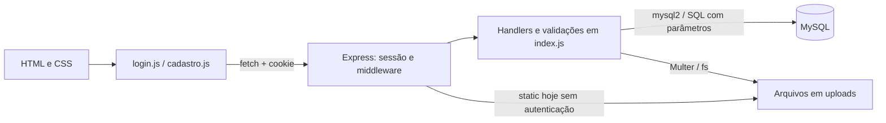

# Auditoria LABHIST — ERS 2.0 × código-fonte

Auditoria concluída em **15 de outubro de 2026**, fuso America/Sao_Paulo. Diretório: `C:\Users\deivi\OneDrive\Documentos\LABHIST`. Foram criados somente documentos desta pasta. Nenhuma funcionalidade foi implementada e nenhum arquivo existente do sistema foi editado.

## Diagnóstico

Há uma base de cadastro de alunos/professores/projetos e envio de documentos, com frontend integrado às rotas e SQL correspondente. Essa base ainda apresenta falhas graves de autenticação, autorização, autoria e validação. Subprojetos e quizzes não possuem implementação correspondente. A página de visitante e a recuperação de senha têm apenas links sem destino funcional. Conteúdos e partes dos quizzes/desempenho dependem da consolidação da ERS.

**Prioridade imediata:** impedir autenticação por seleção de pessoa, proteger senhas/segredos, bloquear operações administrativas por alunos/professores e controlar acesso por vínculo e aos arquivos. Testes isolados reproduziram falhas, mas **não houve validação ponta a ponta com MySQL e navegador reais**. Portanto, o relatório não declara CRUD/arquivos prontos para uso só porque seu caminho de código existe.

## Documentos entregues

- [02 — Matriz dos 86 requisitos e aceite](02-MATRIZ-REQUISITOS.md)
- [03 — Erros, evidências e testes](03-ERROS-ENCONTRADOS.md)
- [04 — Plano, prioridade e dependências](04-PLANO-DE-IMPLEMENTACAO.md)
- [05 — 46 prompts individuais](05-PROMPTS-DE-IMPLEMENTACAO.md)
- [06 — Checklist de tarefas confirmadas](06-PENDENCIAS-DO-PROJETO.md)
- [07 — 12 decisões e divergências da ERS](07-DUVIDAS-DA-ERS.md)
- [08 — Prompt único para imagem do quadro branco](08-PROMPT-QUADRO-BRANCO.md)

Antes de executar tarefas bloqueadas por definição, use o documento 07. A presente entrega é análise e planejamento; os prompts não foram executados.

## Fontes e método

1. Prompt anexado indicado pelo usuário, lido integralmente em UTF-8. Suas instruções foram adotadas por pedido expresso do usuário. Comentários do PDF foram tratados como evidência de requisitos/decisões, sem ampliar a autorização para implementar código.
2. PDF `ESPECIFICAÇÃO DE REQUISITOS DE SOFTWARE (DEIVID).pdf`, caminho em Downloads informado pelo usuário: **20 páginas**, ERS versão 2.0, setembro/2026. Texto completo extraído e lido página a página; tabela de definições incluída. As anotações PDF consultáveis retornaram vazias nas 20 páginas: os comentários relevantes estão incorporados ao conteúdo da página, frequentemente em vermelho.
3. Conferência visual das 20 páginas em prancha de contato; diagrama da p.8 renderizado e lido separadamente em tamanho maior. Foi identificada divergência que não aparecia na extração textual: tabela Alternativas contém Pontuação, enquanto o texto a atribui à pergunta. O diagrama Quizz referencia apenas projeto, sem subprojeto. Não foi presumido modelo de resultado a partir desse desenho.
4. Inventário de todos os arquivos próprios, leitura integral do backend, dos dois scripts frontend, dos dois HTML, dos dois CSS e dos três SQL; package.json e package-lock.json lidos/parseados, dependências instaladas verificadas por npm ls. Sem AGENTS.md encontrado na árvore ou nos diretórios ancestrais consultados. .claude/settings.local.json foi lido como configuração de permissões de outra ferramenta, não como autorização para alterar o produto.
5. Revisão cruzada HTML→handlers→HTTP→middleware→SQL→esquema. Busca por módulos ausentes em toda a fonte própria e scripts SQL. Auditoria de sintaxe e ensaios efêmeros com dependências Express reais, banco/DOM simulados, sem escrita em dados/arquivos do produto.

Python não estava disponível como runtime funcional; a extração usou PDF.js carregado em memória, sem instalação no projeto. A renderização usou a API PDF do Windows e imagens em memória. O helper de renderização encerrou com falha nativa após produzir a imagem completa, que foi inspecionada; isso não corresponde a teste nem falha do LABHIST. Nenhum PDF/documento local foi enviado a um serviço externo para análise. As dependências PDF.js foram apenas obtidas de CDN.

### Cobertura do PDF

| Páginas | Conteúdo lido/conferido |
|---|---|
| 1–5 | Introdução, escopo, notas de remoção/dúvidas, perfis, objetivos e início do processo administrativo. |
| 6–8 | Login/recuperação, validações de aluno, CRUD, projeto/status/período, subprojeto e quiz; diagrama Quizz→Perguntas→Alternativas. |
| 9–11 | Processos aluno/professor/visitante, envio de arquivo/descrição/texto e desempenho; início de RF. |
| 12–14 | RF07–RF52 e RNF01–RNF07. |
| 15–17 | RNF08–RNF11, RS01–RS07, RC01–RC05, RN01–RN11 e interfaces de perfis. |
| 18–20 | Interfaces públicas, validações, entidades, Trello opcional, 12 critérios de aceite e ampliações futuras. |

## Arquitetura e tecnologias

Aplicação web com backend monolítico. Frontend sem framework ou build: HTML, CSS, JavaScript, fetch, FormData e localStorage. O Express serve /login, /mainPage e /assets, além da pasta /uploads hoje indevidamente pública. Backend Node.js com ES modules, Express 5.2.1, express-session 1.19.0, cors 2.8.6, mysql2 3.22.1 e multer 2.2.0; axios 1.15.0 está declarado, sem uso na fonte própria encontrada. Runtime da auditoria: Node 24.19.0 e npm 11.17.0.

Não há controllers/services/models separados, TypeScript, bundler, script de lint, pipeline de build ou suíte de testes configurada. O arquivo server/index.js contém configuração, sessão, DDL, consultas, validações, rotas, uploads e bootstrap. mainPage/cadastro.js concentra navegação, estado, renderização e todas as integrações da página principal. Existem node_modules na raiz e em server; a resolução usada pelo backend foi a instalação sob server.

### Autenticação, sessão e permissões

/login busca conta em usuarios, compara senha diretamente e grava identidade em req.session; login.js grava perfil/usuario no localStorage. /sessao/pessoa pode criar identidade de aluno/professor a partir de ID existente, sem senha, e /pessoas lista nomes/IDs publicamente. A interface consulta localStorage para decidir menus e usa um seletor de pessoas para Meus Projetos. Esses mecanismos não provam identidade acadêmica.

requireAuth só exige identidade na sessão. requireAdmin existe, mas só protege DELETE /documentos; não protege mutações de pessoas, projetos e contas. Quase todas as leituras acadêmicas recebem dados globais, depois filtrados no navegador. express-session usa store padrão em memória, sem regeneração no login nem prazo explícito de cookie. CORS reflete origem arbitrária com credentials e secure=false é fixo; parâmetros de implantação não estão configurados. O teste T09 confirma que a exclusão administrativa de documentos já tem uma proteção que deve ser preservada.

### Entidades e relações efetivamente encontradas

| Entidade | Persistência / relacionamento | Diagnóstico |
|---|---|---|
| usuarios | Conta com usuario UNIQUE, senha e perfil; administrador é um perfil. | Sem vínculo com professor/aluno; senha em texto puro. |
| professor | Cadastro com nome, e-mail, telefone e matrícula. | Sem credencial vinculada ou regra de unicidade de pessoa. |
| aluno | Nome, matrícula, e-mail, telefone, curso e turma. | Curso/turma como texto; obrigatórios expressos na ERS não validados. |
| projeto | Título, descrição, objetivo, professor_id e datas no DDL. | Sem status; datas não integradas; professor_id não tem FK no DDL. |
| projeto_professor | Associação N:N; UNIQUE(projeto_id, professor_id). | Sem FKs no DDL e sem validação de existência de todos os IDs. |
| projeto_aluno | Associação N:N; UNIQUE(projeto_id, aluno_id). | Participação gerida pelo administrador; sem filtro seguro de acesso. |
| documentos | Script externo com projeto, descrição, caminho/nome do arquivo, enviado_por e timestamp. | API espera também enviado_por_perfil; migrações separam esse campo e retiram FK incompatível do autor. FK de projeto com cascade existe no script, aplicação real não verificada. |

Não foram encontradas entidades/rotas correspondentes a Subprojeto, Conteúdo, Edital, Quiz, Questão, Alternativa, Resposta ou Resultado. Participação já tem representação por projeto_aluno; Arquivo é representado em documentos; Curso/Turma e Administrador não precisam obrigatoriamente de tabela própria para atender a ERS, que deixa modelagem para fase posterior. Ausência de tabela com um nome específico não foi tratada como defeito isoladamente.

### Funcionalidades atuais e alcance real

- Login de conta com sessão de servidor e retorno de erro para credencial inválida; falta segurança da senha e vínculo de identidade acadêmica.
- Cadastros, consultas, edições e exclusões de alunos/professores, busca por nome e filtro por curso; autorização/validação incompletas.
- CRUD de projeto, descrição/objetivo e múltiplos professores/alunos, com tentativa de transação; sem status e integridade suficiente.
- Meus Projetos com seleção manual de identidade e filtro local; detalhe acadêmico mostra título/documentos, sem objetivo/descrição.
- Envio de documento com descrição, prévia de nome/tamanho, UUID e extensão permitida; leitura de metadados e download direto; data/autoria com falhas de autorização e colisão de IDs.
- Sidebar/overlay responsivos, ações de voltar/limpar/sair e estados de vazio/carregamento. Compatibilidade real e usabilidade não foram homologadas.

## Resumo dos 86 requisitos

| Situação | Quantidade |
|---|---:|
| IMPLEMENTADO COM ERROS | 32 |
| NÃO IMPLEMENTADO | 23 |
| IMPLEMENTADO | 1 |
| PENDENTE DE DEFINIÇÃO | 9 |
| REMOVIDO DO ESCOPO | 6 |
| PARCIALMENTE IMPLEMENTADO | 7 |
| NÃO VERIFICADO | 8 |
| **TOTAL** | **86** |

Distribuição: 52 RF + 11 RNF + 7 RS + 5 RC + 11 RN. Os processos, interfaces e os 12 critérios gerais de aceite também foram confrontados no documento 02, sem inventar IDs oficiais.

### Estimativa de cobertura: 21,43%

Foram considerados **63 requisitos confirmados e avaliáveis**. Excluídos: 9 pendentes de definição, 6 removidos e 8 não verificados (23 ao todo).

- 1 IMPLEMENTADO × 1,00 = 1,0 ponto.
- 7 PARCIALMENTE IMPLEMENTADOS × 0,50 = 3,5 pontos.
- 23 NÃO IMPLEMENTADOS × 0,00 = 0 ponto.
- 32 IMPLEMENTADOS COM ERROS: 18 recebem 0,50 e 14 recebem 0,00 = 9,0 pontos.
- **(1,0 + 3,5 + 9,0) / 63 × 100 = 21,43%.**

Os erros recebem 0 quando destroem a garantia central: RF01/RF04/RF47, RS01–RS07 e RN01/RN02/RN06/RN08. Recebem 50% os 18 demais requisitos com erros, pois existe caminho reconhecível de dados (CRUD/descrição/participação/metadados/mensagens), embora precise de correção. Isso não reduz a gravidade das falhas de segurança desses fluxos. Os pesos individuais estão registrados na matriz.

**Esse número estima cobertura dos requisitos, sem ponderação de tamanho, qualidade, risco ou esforço restante. Não significa que o sistema esteja 21,43% pronto para implantação.** RNF e regras se sobrepõem a RF; portanto, o cálculo solicitado não representa pontos de função nem conclusão de um cronograma. Sem crédito para todos os itens com erros, a estimativa seria 7,14%; essa sensibilidade mostra a limitação da métrica.

## Problemas prioritários e escopo

São 23 achados: 3 críticos, 9 altos, 10 médios e 1 baixo, com categorias e evidências no documento 03. Autenticação por seleção, senha insegura e escalada administrativa vêm primeiro. Acesso global a dados, bytes de upload públicos e autoria polimórfica falha vêm a seguir, com migração/conexão como dependências. Falta validação de formulários, integridade de relações, tratamento de erros e limpeza de arquivos.

Conteúdos não estão confirmados; editais possuem nota explícita de remoção; publicação/pontuação/vínculo do quiz e evolução do aprendizado aguardam definição. Nenhum desses itens ganhou implementação automática. O núcleo confirmado de quizzes e as consultas mínimas têm prompts separados e bloqueios claros quando dependem dessas decisões. Após resolver D03/D04/D08, será necessário produzir os prompts específicos de vínculo, publicação e cálculo; eles não foram inventados nesta auditoria.

## Verificações e limites

Sintaxe JavaScript: três verificações passaram. npm test falhou por ser placeholder. npm ls resolveu a árvore instalada. Ensaios HTTP isolados T01–T12 e um ensaio de formulário confirmaram caminhos e falhas sem usar banco real. Consulte o documento 03 para pedidos, fixtures, resultados e correções do próprio ensaio T04/T12.

Não iniciado o servidor original porque seu bootstrap altera schema e cria conta. Não foram executadas migrações, consultas de dados reais, persistência ponta a ponta, uploads reais, benchmark, navegador ou dispositivos móveis. Arquivos .env não foram exibidos; nenhum foi encontrado no inventário próprio. Valores de senhas, segredos e credenciais não são reproduzidos nesta documentação. A instalação real do MySQL, conteúdo dos dados e schema efetivamente aplicado continuam não verificados.

Imagens em assets e prints_relatorio foram inventariadas; os prints são históricos e não demonstram o funcionamento atual. Código de terceiros em node_modules não foi auditado linha a linha. Não houve consulta externa a documentação técnica/CVEs para afirmar vulnerabilidades de pacotes; os problemas reportados decorrem da fonte local e dos ensaios.

## Inventário e preservação

Foram inventariados 21 arquivos existentes fora de node_modules: 13 arquivos de fonte/configuração/SQL/manifesto e 8 imagens. A tabela abaixo registra o SHA-256 observado antes da escrita dos documentos. A verificação final confirmou os 21 arquivos com os mesmos hashes e tamanhos; nenhum arquivo novo apareceu fora da documentação. A pasta não era um repositório Git reconhecido: git status informou ausência de .git, por isso a preservação usa hashes, não diff.

| Arquivo | Bytes | SHA-256 |
|---|---:|---|
| .claude/settings.local.json | 1390 | `15085f8d21877aa3efd53001665de34822470ca3df0381ea17e26181363dbb11` |
| assets/logo.png | 68360 | `908e1cd934e90dde7715d9c71c1b1c9f9b70c419a00802ffb084630bf5a379ea` |
| assets/logofundo.png | 105703 | `498dfb68ab18aec349349633e648b5bc63e489e4499429affa96b8d249a85479` |
| assets/unnamed.png | 79573 | `21b7055d561fa04f21aaa96bf5b6264cb03177a0ab4fabd0ebcb8159b2b05367` |
| login/login.css | 3956 | `2175800237585325d83aed08411501d25a9587fc7af7df7c9d91a10eef8064e4` |
| login/login.html | 953 | `b54b4169fe65c3e9033b6bc166aec2c85669a64c3375626a5f5abe024d13b4d5` |
| login/login.js | 1084 | `fc6e367c8dde1c96647409853e062f370f9ca7ed3c41449a37691e23098686fe` |
| mainPage/cadastro.js | 40776 | `55876b2eb7d2579acc94d80df8f0b9b891140d69282d898088a4b58dff165ad9` |
| mainPage/menu.css | 28021 | `c206b49ffa7a31e497a55834d766bde64674fdab8fdc151c43166268e017e76c` |
| mainPage/menuCadastro.html | 21320 | `225703c90ab36ee76af28ca182d772aef8830949bdb478e26fbdd79543cfaac2` |
| prints_relatorio/01_login.png | 103619 | `18ddfdd627a5447427d869ee40f3ffa53501538f9ff1be366203c103793c3c92` |
| prints_relatorio/02_tela_inicial.png | 125063 | `c94d8e8f1754696c8f63e3e967e3ea4ee9518a28ab7587fbad354b7e887f0284` |
| prints_relatorio/03_lista_professores.png | 143654 | `23b0c549c671a08488deddb74de954bab169e2e9c02bff201314eea03a22ca38` |
| prints_relatorio/04_lista_alunos.png | 149696 | `651dbcdfff568601d9ea4c3a2879a0cd58b24b84e964e36d14a701a3feb26855` |
| prints_relatorio/06_cadastro_professor.png | 151164 | `e0077e763efde5f620563921284eacf748b4fa1826bd5a2683f7212799d04d52` |
| server/index.js | 34983 | `8222e455fdebf656731436381eb9116318421e529c5bb74d46d3ba0517537981` |
| server/package-lock.json | 48126 | `2dc23594aa6b98c02957398c46d157f4bdff77d23f22e556629695e79ce8be07` |
| server/package.json | 426 | `e9f33f38f4d213963ea253eed37f070768eee0a80cba7d535d347b0443f44549` |
| server/sql/documentos.sql | 642 | `d6d87d567690ee31db91775508a714946a62271dea4d223df52cb6ed7f1a27c0` |
| server/sql/documentos_add_enviado_por_perfil.sql | 620 | `fa7abe327aacbca6f8f9cb146594482df5e0acc2bcf9ac082a49f8f0d937f2f9` |
| server/sql/documentos_remover_fk_enviado_por.sql | 1452 | `0c156f4493e5f7100a65cc0174ada993535ff47c06bc96299cd5c61ea13e0dd4` |

## Encerramento e próximos passos

Etapas 1–7 concluídas: leitura, comparação, auditoria técnica, relatório, plano/prompts, documentação e prompt da imagem. Os 86 requisitos têm classificação única. Existem 46 tarefas/prompt com correspondência no plano, checklist e quadro; módulos indefinidos/removidos ficam nas 12 decisões, sem expansão silenciosa de escopo.

Comece por P01/P02/P03; organize banco isolado em P04/P05 para concluir P06–P10 e validar persistência. Resolva as decisões relevantes antes dos prompts bloqueados, em especial os de quiz e recuperação de senha. Execute um prompt por vez, reavalie as evidências após cada entrega e atualize a matriz; esta auditoria é uma fotografia, não uma prova permanente de conformidade.
